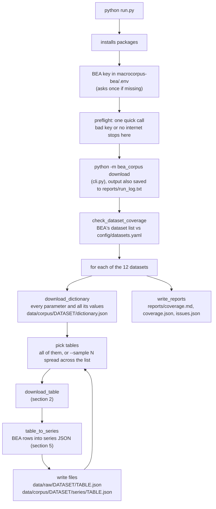
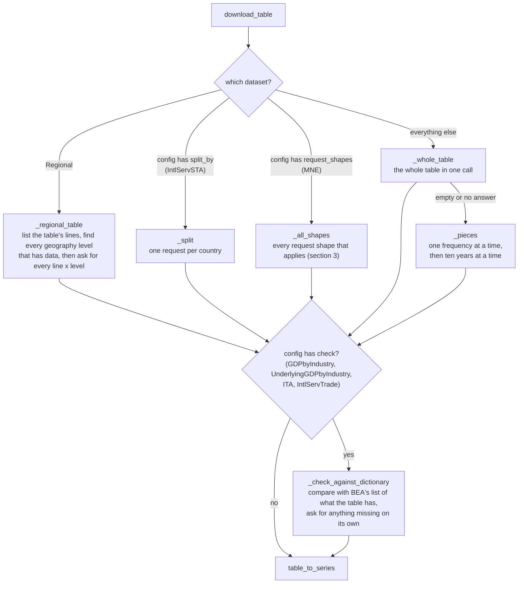
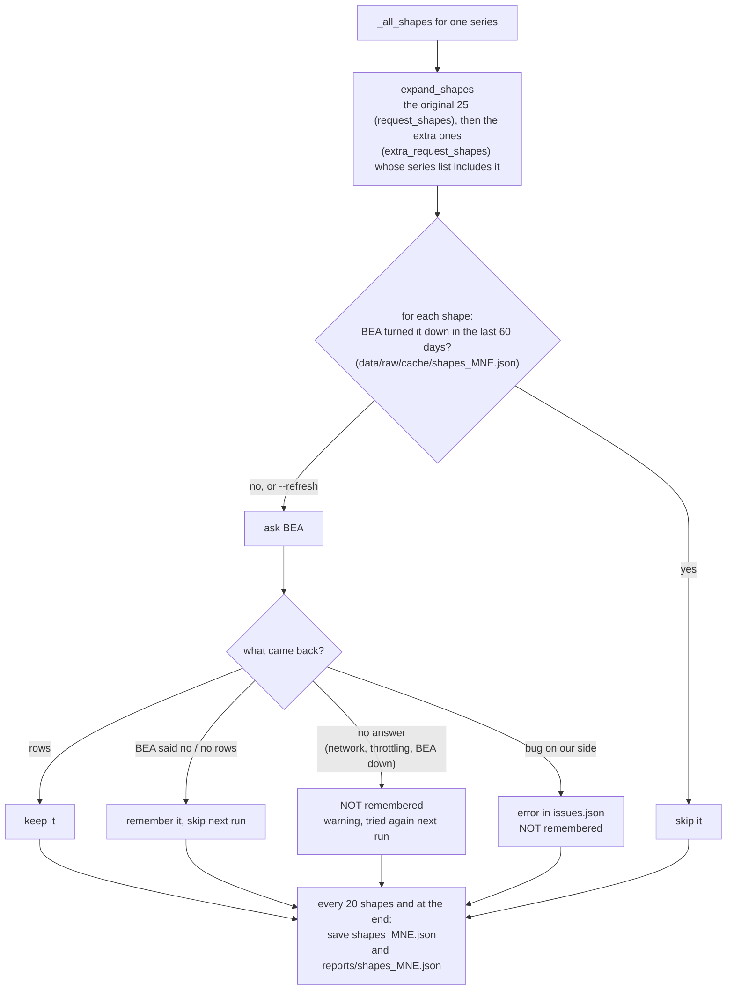
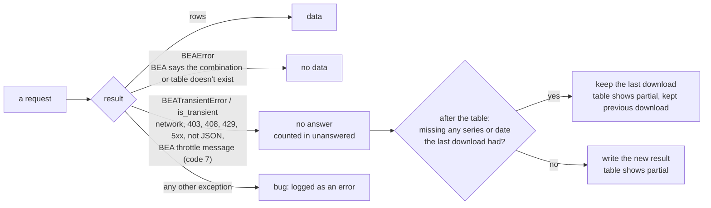

# How the BEA download works

What `python run.py` does from start to finish, and where to look when something goes wrong. Function names are in `macrocorpus-bea/src/bea_corpus/`; most of it is `download.py`.

## 1. The whole run

Every request goes through `client.py` (`BEAClient`). It keeps under BEA's limits (100 requests, 100 MB and 30 errors a minute), saves every answered response in `data/raw/cache/`, and retries network trouble before giving up.

## 2. One table: which route it takes

The route depends on the dataset's block in `config/datasets.yaml`.

## 3. MNE: the request shapes

Each MNE series only exists for some directions (outward, inward, parent, state), classifications and ownership levels. So every shape that applies is tried and every one with data is kept.

The 9 series BEA lists as discontinued (11, 13, 16, 19, 50, 51, 52, 55, 56) are logged as `info`, not `error`, when nothing comes back.

## 4. What happens to every request

This is the part that matters most for debugging. "BEA said no" and "BEA didn't answer" are handled differently on purpose.

If BEA doesn't answer when the dictionary asks for one parameter's values, it's named under `no_answer` in `dictionary.json` and the list from the last run is used if there is one. If there's no old list, any table that needed it keeps its last download.

## 5. BEA rows into series (`table_to_series` in standardize_json.py)

1. Group rows by their code columns plus frequency. Labels don't split a series, so a renamed country stays one series and the names go in `label_history`.
2. If one code holds several measures told apart only by their labels, split them.
3. For MNE, older years (`NonbankAffiliatesOnly=1`) and newer years (`=0`) join into one history, and `definition_history` says where it switches.
4. Every date is put in order, and missing values become null.
5. `merge_identical`: series with exactly the same dates, values and units become one. The extra ids are listed under `also_as`. For MNE, which id stays on top goes: a series built only from the original 25 shapes, then one that joins original and extra shapes, then one from extra shapes only. Within each, the smallest id wins. So adding the extra shapes never takes an id away from a series that `main` already had.

## Where to look when something's wrong

| Symptom | Look at |
|---|---|
| A dataset or table failed | `reports/coverage.md` (status per table), then `reports/issues.json` for that table |
| "rerun to try again" / "didn't answer" | BEA was busy or the network dropped. Rerun: it skips everything already downloaded |
| An MNE series has no data | `reports/shapes_MNE.json`: every shape tried for it and BEA's exact reason for each "no" |
| `no_answer` in a `dictionary.json` | BEA didn't answer for that list this run, so it's last run's list (or missing) |
| A series id disappeared | its `also_as` in the series file: it was merged into an identical series |
| Odd jump in an MNE series | its `definition_history`: before the switch year it's nonbank affiliates only |
| Want BEA asked again from scratch | `--refresh` (ignores saved responses and remembered refusals) |
| Changed the JSON format | `python -m bea_corpus standardize` rebuilds it from `data/raw/` with no downloading |
| What exactly was run and printed | `reports/run_log.txt` |
